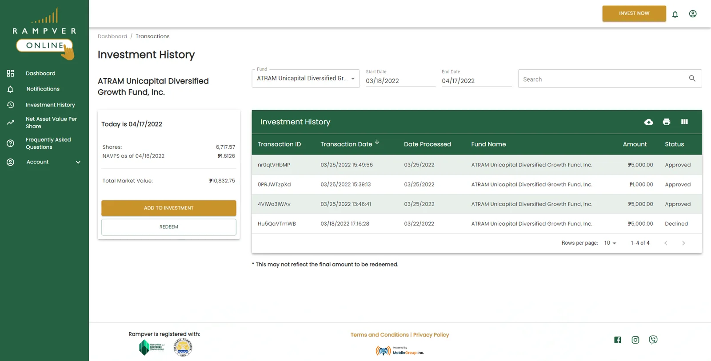
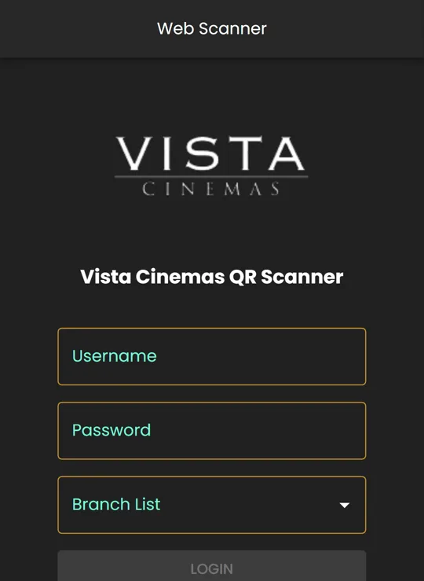

<!--
This file is the website's content. index.html reads it at runtime.
Rules the site depends on:
- Keep the section titles: Contact, Professional Summary, Work Experience, Education, Projects.
- The line under "# Name" is the headline.
- "## " starts a section, "### " starts an entry inside it.
- The first line under an entry heading is its meta line, parts separated by " · ".
  Experience/Education: last part is the date range.
- Projects: "**Tech Stack:**" line lists tech, comma-separated. An image line adds a screenshot.
- Contact: one "- Label: [text](url)" item per line.
-->

# Alex Cristi

Frontend Software Engineer (Part-Lead) · Samsung R&D Philippines · Manila, Philippines

## Contact

- Email: [ajcristi96@gmail.com](mailto:ajcristi96@gmail.com)
- GitHub: [github.com/AJCristi](https://github.com/AJCristi)
- LinkedIn: [linkedin.com/in/alex-cristi-0bb9bb1a2](https://www.linkedin.com/in/alex-cristi-0bb9bb1a2/)

## Professional Summary

Full Stack Software Engineer with 5+ years of experience building and scaling web applications. Currently part-leading a frontend team at Samsung R&D Philippines, where I spearhead a large-scale internal platform used for training LLMs across multiple divisions. Proven track record in delivering end-to-end solutions from architecting NoSQL databases on GCP to developing multi-platform applications with React, TypeScript, and Node.js.

## Work Experience

### Frontend Software Engineer (Part-Lead)

Samsung Research & Development Philippines · Taguig, Metro Manila · January 2022 – Present

- **Frontend modernization:** Collaborated with overseas counterparts (Korea, CAN, UK, PL) and local teams to migrate a large-scale legacy JavaScript application to TypeScript using modern React patterns, improving code maintainability and reducing runtime errors by establishing strict type safety across all modules and components
- **Enterprise ML platform:** Spearheaded frontend development for an internal machine learning platform now utilized by multiple Samsung divisions for training Large Language Models (LLMs) across various AI/ML projects including natural language processing and computer vision applications
- **Optimized legacy system performance:** Maintained and upgraded a legacy project to feature-complete status, implementing code splitting, lazy loading, and caching strategies that resulted in 40% faster initial load times and significantly enhanced application stability
- **Cross-functional coordination:** Served as primary liaison between international development teams (Korea, CAN, UK, PL), QA engineers, DevOps, and UI/UX designers, ensuring seamless deployment pipelines, comprehensive test coverage, and pixel-perfect design implementation
- **Built internal tooling:** Contributed to department-wide initiatives including shared component libraries, internal documentation systems, and localized business tools that improved developer productivity across teams
- **Talent acquisition & mentorship:** Conducted technical recruitment interviews, evaluating candidates on JavaScript/TypeScript proficiency and React expertise. Mentored and onboarded new team members, creating training materials and conducting knowledge transfer sessions
- **Innovation & prototyping:** Developed multiple Proof-of-Concept features exploring new technologies and user experience improvements, several of which were approved and integrated into the production product roadmap

### Full Stack Software Engineer

MobileGroup Inc. · Makati, Metro Manila · January 2020 – December 2021

- **Architected multi-platform investment solution:** Spearheaded the complete architectural redesign of the 'Rampver Digital Investment Platform', transitioning from a web-only solution to a unified codebase supporting iOS, Android, and web using Next.js and React Native, reducing development time for new features by 60%
- **Delivered high-impact fintech product:** Developed and launched a comprehensive Digital Investment Platform for Rampver Financials, consisting of 3 interconnected modules (Client Portal, Admin CMS, Agent Dashboard) built with React.js and Firebase, successfully onboarding 3,000+ active users within the first year
- **Designed scalable database architecture:** Devised and implemented a NoSQL database schema using Firebase Firestore on Google Cloud Platform, optimizing for high-read scenarios and real-time data synchronization across all platform modules while maintaining data integrity for financial transactions
- **Built serverless API infrastructure:** Created and deployed a robust RESTful API layer using GCP Cloud Functions and Firebase Cloud Functions, handling authentication, transaction processing, and real-time notifications with 99.9% uptime
- **Developed operational efficiency tools:** Built a ticket scanning application for Vistamalls Cinema employees using React.js, Material UI, and Node.js backend, streamlining ticket validation processes, reducing queue times by 50%, and serving as a reliable backup system during hardware failures
- **Maintained enterprise POS systems:** Upgraded and maintained a C# .NET POS-CMS system for notable retail clients, implementing new payment integrations, inventory management features, and generating detailed sales analytics reports

### Software Developer Intern

Intercommerce Inc. · March – October 2018

- Created working mockups of website designs using JavaScript, HTML, and CSS
- Assisted in building an Android application in Java with a MySQL database

## Education

### BS Information Technology

De La Salle – College of Saint Benilde · Specialization in Game Design and Development · 2019

Learned C# and JavaScript alongside software development best practices. Created 2 games as capstone and thesis projects.

## Skills

- **Languages:** JavaScript, TypeScript, SQL
- **Frameworks & Libraries:** React.js, Next.js, Node.js, Express.js, Material UI
- **Backend & Cloud:** Firebase, Google Cloud Platform (GCP), Firebase Cloud Functions, Firestore
- **Databases:** MariaDB, MySQL, NoSQL (Firestore)
- **Methodologies:** Agile, Scrum, Kanban

## Projects

### Samsung Machine Learning Platform

Internal tool · no public screenshots

**Tech Stack:** TypeScript, React.js, Node.js, MariaDB, Docker

Enterprise-grade internal machine learning platform designed for training and fine-tuning Large Language Models (LLMs). The platform provides an intuitive interface for data scientists and ML engineers to upload training datasets, configure model parameters, monitor training progress in real-time, and deploy models for inference. Currently utilized by multiple Samsung divisions and R&D teams for natural language processing, sentiment analysis, and conversational AI projects. Features include batch processing, experiment tracking, model versioning, and integration with Samsung's internal cloud infrastructure.

**Key Contributions:**

- Architected the frontend dashboard for real-time training metrics visualization
- Implemented drag-and-drop dataset upload with progress tracking and validation
- Built collaborative features allowing teams to share models and training configurations

### Rampver Digital Investment Platform

[app.rampver.com](https://app.rampver.com)

**Tech Stack:** JavaScript, React.js, Next.js, Node.js, Firebase, GCP

Comprehensive digital investment platform for Rampver Financials, one of the Philippines' growing investment companies. The platform consists of three interconnected modules: a client-facing portal for investors to view portfolios, track performance, and request transactions; an administrative CMS for back-office operations; and an agent dashboard for financial advisors to manage client relationships. Built with a serverless architecture on Google Cloud Platform, featuring real-time data synchronization, secure document storage, and automated notification systems.

**Key Contributions:**

- Designed and implemented the complete frontend architecture using React.js with Redux state management
- Built real-time portfolio tracking with live market data integration
- Developed secure document upload and KYC verification workflows
- Created responsive mobile-first design serving 3,000+ active investors

### Ticket Scanner for Vistamalls Cinema

Progressive Web App · cinema staff

**Tech Stack:** JavaScript, React.js, Material UI, Node.js, Express.js, MySQL

Progressive Web Application (PWA) developed for Vistamalls Cinema operations to digitize and streamline the ticket validation process. The application allows cinema staff to scan QR codes on digital or printed tickets, instantly validate authenticity against the booking database, and track theater occupancy in real-time. Designed to work offline with synchronization capabilities, ensuring continuous operation even during network interruptions.

**Key Contributions:**

- Built QR code scanning functionality using device cameras with fallback manual entry
- Implemented offline-first architecture with background sync for unreliable network conditions
- Created admin dashboard for real-time occupancy monitoring and analytics
- Reduced average ticket validation time from 15 seconds to under 3 seconds
